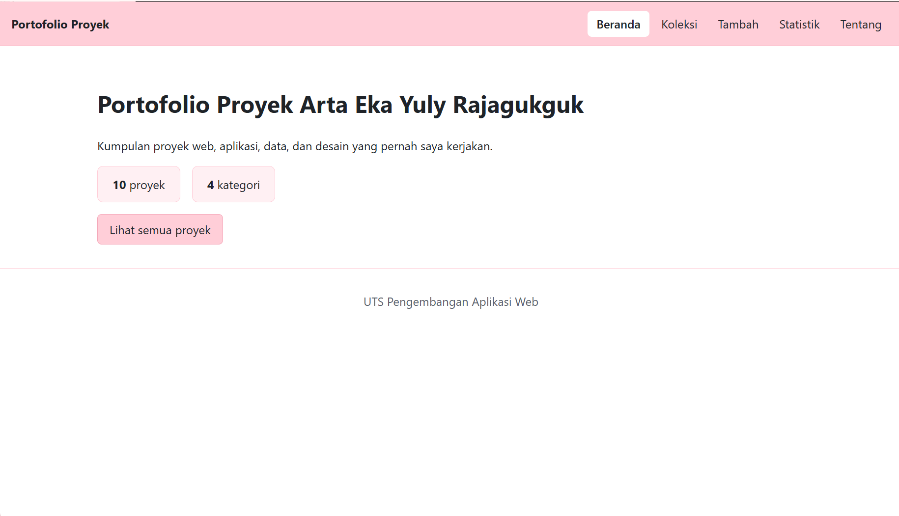

# Portofolio Proyek

Aplikasi web untuk mendata dan menampilkan proyek-proyek yang pernah saya kerjakan. Dibuat dengan React untuk Ujian Tengah Semester Pengembangan Aplikasi Web (IF25-22014).

| | |
|---|---|
| **Nama** | Arta Eka Yuly Rajagukguk |
| **NIM** | 123140209 |
| **Kelas** | RB |
| **Tema** | Portofolio Proyek |
| **Deployment** | https://artaeka.github.io/uts-paw/ |



## Fitur

- Beranda dengan ringkasan jumlah proyek dan kategori
- Daftar proyek (`/koleksi`) dimuat dengan fetch, dilengkapi pencarian judul
- Detail proyek (`/koleksi/:id`) dengan field Teknologi, Tahun, dan Tautan, serta tombol Hapus
- Form tambah proyek (`/tambah`) dengan validasi judul, disimpan ke localStorage
- Statistik jumlah proyek per kategori dalam tabel (`/statistik`)
- Halaman Tentang (`/tentang`) dan halaman 404 untuk rute yang tidak dikenal

## Menjalankan secara lokal

```bash
cd app
npm install
npm run dev
```

Perintah lain di folder `app/`:

```bash
npm test        # menjalankan test (Vitest + Testing Library)
npm run lint    # memeriksa kode dengan oxlint
npm run build   # membuat build produksi
npm run cek     # perkiraan nilai rubrik
```

## Struktur kode

```
app/src/
├── components/   TataLetak, KotakPencarian, KartuItem, PesanError, IndikatorForm
├── context/      KoleksiContext.jsx (Provider dan Context koleksi)
├── hooks/        useLocalStorage.js, useKoleksi.js
├── pages/        Beranda, Koleksi, Detail, Tambah, Statistik, Tentang, TidakDitemukan
├── App.jsx       daftar rute
└── App.test.jsx  test buatan sendiri
```

Data awal ada di `app/public/data/koleksi.json`. Proyek yang ditambahkan lewat form dan proyek yang dihapus dicatat terpisah di localStorage, sehingga file JSON tidak berubah.

## Konsep React yang dipakai

1. **useState dan useEffect**
   Dipakai di `src/context/KoleksiContext.jsx` untuk menyimpan data koleksi, status `loading`, dan `error`, serta memuat data saat aplikasi pertama kali dibuka. `useState` juga dipakai di `src/pages/Koleksi.jsx` (kata pencarian) dan `src/pages/Tambah.jsx` (isi form dan pesan error). `useEffect` dipakai juga di `src/hooks/useLocalStorage.js` untuk menyimpan nilai ke localStorage setiap kali berubah.

2. **Fetch dengan async/await, loading, dan error**
   Di `src/context/KoleksiContext.jsx`, data diambil dari `data/koleksi.json` dengan `async/await` di dalam `try/catch/finally`. State `loading` menampilkan teks "Memuat..." di setiap halaman, dan state `error` ditampilkan lewat komponen `PesanError`.

3. **Context API**
   `createContext` dan `Provider` ada di `src/context/KoleksiContext.jsx`, sedangkan `useContext` dipakai di `src/hooks/useKoleksi.js`. Context menyimpan daftar koleksi beserta fungsi `tambahItem` dan `hapusItem`, dan dipakai oleh halaman Beranda, Koleksi, Detail, Tambah, dan Statistik.

4. **Custom hook** (`src/hooks/`)
   - `useLocalStorage`: state yang otomatis tersimpan dan dibaca kembali dari localStorage.
   - `useKoleksi`: membaca context koleksi dan memberi pesan error yang jelas bila dipakai di luar Provider.

5. **React Router**
   Rute yang dipakai: `/`, `/koleksi`, `/koleksi/:id`, `/tambah`, `/statistik`, `/tentang`, dan `*` (404). `useParams` dipakai di `src/pages/Detail.jsx` untuk membaca id, `useNavigate` dipakai di `Detail.jsx` (kembali ke koleksi setelah hapus) dan `Tambah.jsx` (pindah ke koleksi setelah simpan), dan `NavLink` dipakai di `src/components/TataLetak.jsx` untuk menu navigasi. `Link` dipakai di `KartuItem.jsx` menuju halaman detail.

6. **Komponen terpisah** (`src/components/`)
   `TataLetak`, `KotakPencarian`, `KartuItem`, `PesanError`, `IndikatorForm`. Masing-masing punya berkas CSS sendiri.

7. **JavaScript modern**
   Destructuring, spread, template literal, dan `map`/`filter`/`reduce` dipakai di banyak berkas. Contohnya `reduce` untuk menghitung jumlah proyek per kategori di `src/pages/Statistik.jsx`, spread untuk menggabungkan data awal dan proyek baru di `KoleksiContext.jsx`, template literal untuk membentuk alamat `/koleksi/${id}` di `KartuItem.jsx`, dan `filter` untuk pencarian judul di `src/pages/Koleksi.jsx`.